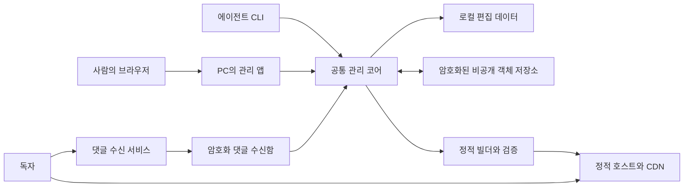

# 로컬 관리와 암호화 동기화 중심의 제품 설계 제안

> 상태: 승인된 목표 설계. 구현 진행 중이며 제품 전환은 미완료다.
> 작성일: 2026-10-23. 검토일: 2026-10-24.
> 범위: 제품 경계, 데이터 소유권, 동기화, 보안, 발행, 댓글.

## 설계의 출발점

운영자는 PC에서 관리 앱을 실행하고 브라우저로 매체를 관리한다.
에이전트는 CLI 또는 로컬 API를 사용한다. 웹 UI와 CLI는 각각 모든 관리
작업을 끝낼 수 있어야 한다. 원격 관리자 웹사이트와 서버 DB는 필수 구성이
아니다.

공개 사이트는 운영자 PC가 꺼져 있어도 동작한다. 비공개 원본과 복구용
데이터는 객체 스토리지에 암호화해서 저장한다. 공개 기사, 공개용 이미지,
검색, 피드, SEO 메타데이터는 정적 호스트와 CDN에서 제공한다.

이 문서는 PostgreSQL 중심의 현행 구현을 설명하지 않는다. 새 설계의
비교·선택 결과와 완료 시 지켜야 할 계약을 다룬다. 2026-10-24 구현 승인을
받았다. 현행 호출 경로는 [개발 스펙](../development-spec.md)에 있으며,
검증된 교체 전까지 이를 완료된 로컬 관리 제품으로 설명하지 않는다.

## 제품과 인터페이스의 경계

| 제품                       | 소유하는 책임                                                                               | 실행 위치                                  | 원격 필수 구성                     |
| -------------------------- | ------------------------------------------------------------------------------------------- | ------------------------------------------ | ---------------------------------- |
| Publisher 관리 앱          | 다중 매체, 기사·기자·분류·지침·어댑터 설정, 미디어, 로컬 저장, 동기화, 발행·복구, 댓글 승인 | PC 또는 운영자가 선택한 에이전트 실행 환경 | 암호화 동기화용 객체 스토리지      |
| Publisher 공개 사이트      | 공개 HTML, 이미지, 검색·피드·사이트맵, 테마, 승인 댓글 읽기                                 | 정적 호스트와 CDN                          | 완성된 배포물을 보관하는 정적 원본 |
| Publisher 댓글 수신 서비스 | PC가 꺼진 동안의 댓글 접수, 입력 검증, 남용 제어, 암호화 수신함 기록                        | 별도 작은 온라인 런타임                    | 비공개 객체 수신함. 서버 DB 불필요 |

웹 UI, CLI, API는 관리 앱의 인터페이스다. 각 인터페이스에 별도 비즈니스
규칙이나 별도 데이터 원본을 두지 않는다. CLI는 웹 UI를 열지 않고 동작하며,
웹 UI도 정상 관리 작업을 위해 사용자에게 CLI 실행을 요구하지 않는다.

동기화, 암호화, 빌더는 관리 앱 내부 모듈이다. 이 이름을 붙였다고 별도
네트워크 서비스나 호스팅 계정을 추가하지 않는다. Desk Plugin은 CLI를
이용하는 에이전트용 배포 패키지이며 콘텐츠 저장소나 발행 권위가 아니다.

## 기능 동등성 계약

다음 작업은 웹 UI와 CLI·로컬 API에서 모두 제공한다. UI에서는 화면의 작업
결과로, CLI에서는 버전된 JSON과 안정된 오류 코드로 상태를 확인한다.

| 기능                                                                 | 웹 UI의 완료 경로        | CLI·로컬 API의 완료 경로        |
| -------------------------------------------------------------------- | ------------------------ | ------------------------------- |
| 작업공간 생성·열기·잠금·복구                                         | 초기 설정과 복구 화면    | workspace 명령과 같은 코어 연산 |
| 매체 생성·선택·설정·보관                                             | 매체 관리 화면           | site 연산                       |
| 로컬 사용자·역할·매체 권한·브라우저 연결·에이전트 자격증명 발급·폐기 | 계정·권한·연결 관리 화면 | identity·access 연산            |
| 기사·언어별 본문·기자·페르소나                                       | 편집·기자 관리 화면      | post·article·author 연산        |
| 분류·태그·운영 지침·어댑터                                           | 분류·지침·설정 화면      | taxonomy·guidance·adapter 연산  |
| 이미지 등록·검증·승인·출처                                           | 미디어 관리 화면         | media 연산                      |
| 데스크 검토와 발행 승인                                              | 검토 화면                | desk 연산                       |
| 동기화·충돌 확인·기기 인계                                           | 동기화·이력 화면         | sync·history 연산               |
| 빌드·배포·작업 조회·롤백                                             | 발행·작업 화면           | publish·operation 연산          |
| 댓글 가져오기·승인·거절·반영                                         | 댓글 관리 화면           | comments 연산                   |
| 키 백업·복구·교체·접근 폐기                                          | 보안·복구 화면           | key·access 연산                 |
| 호스트 연결과 상태 진단                                              | 연결·진단 화면           | target·doctor 연산              |

표의 명령 그룹과 연산은 제안이며 현재 실행 가능한 명령 목록이 아니다.
구현 시 하나의 capability 정의에서 요청·결과·권한·가용성 계약을 공유하고,
양쪽 경로를 실제로 실행하는 검증이 있어야 한다. 패널 파일이나 CLI 명령
이름이 존재한다는 이유만으로 기능 동등성을 통과시키지 않는다.

## 데이터와 완료 상태를 구분한다

| 상태             | 의미                                                         | 보장하지 않는 것                         |
| ---------------- | ------------------------------------------------------------ | ---------------------------------------- |
| 로컬 저장        | 이 PC의 편집 트랜잭션이 완료됨                               | 다른 기기 복구, 원격 저장, 사이트 반영   |
| 원격 동기화      | 암호화된 원본과 참조 파일이 저장되고 원격 버전 확정이 관찰됨 | 공개 사이트 변경                         |
| 빌드 검증 완료   | 특정 편집 버전의 공개 산출물 검사 통과                       | 호스트 업로드·공개 활성화                |
| 공개 활성화 확인 | 선택 호스트에서 해당 릴리스가 활성화됐음이 확인됨            | 모든 CDN 지점의 즉시 교체                |
| 공개 검증 완료   | 정식 도메인의 릴리스 식별자·대표 경로·정책 관찰 완료         | 관찰하지 않은 모든 지역·기기의 동일 응답 |

저장·동기화·발행을 하나의 `성공` 상태로 합치지 않는다. 작업 중 응답이
끊기면 실패로 단정하거나 새 작업을 시작하지 않고 같은 작업 ID로 상태를
확인한다. 외부 결과가 확인되지 않으면 `reconciling` 상태를 유지한다.

새 기기 복구의 기준은 원격에 확정된 버전이다. 동기화하지 않은 로컬 변경은
해당 PC에만 존재한다. UI와 CLI는 이 차이와 마지막 동기화 시점을 표시한다.

## 로컬 관리 앱의 보안

기본 수신 주소는 loopback이다. LAN과 인터넷에 관리자 API를 노출하지 않는다.
브라우저 요청은 정확한 Host·Origin과 세션·CSRF 검증을 통과해야 한다.
외부 웹페이지가 로컬 포트에 요청할 수 있다는 이유만으로 관리 권한을 얻으면
안 된다. DNS rebinding과 CORS wildcard 허용도 차단한다.

관리 앱 프로세스가 스토리지 자격증명과 암호화 키를 보관한다. 브라우저의
localStorage, URL, CLI 인자, 진단 출력에 이 값을 넣지 않는다. 웹 세션과
에이전트 접근 권한은 각각 폐기 가능해야 하며 매체와 작업 범위를 제한한다.

가져온 Markdown·댓글·이미지 메타데이터도 신뢰하지 않는다. 관리자 미리보기와
공개 투영은 안전한 렌더러·HTML 정제·embed 허용 목록을 사용한다. 임의 HTML
미리보기를 관리자 세션과 같은 권한으로 실행하지 않는다. sandbox와 CSP가
외부 문서의 스크립트에 관리 API 권한을 주지 않아야 한다.

같은 OS 계정에서 DB와 키 저장소를 직접 읽을 수 있는 악성 프로세스까지
API 토큰의 권한 범위로 격리한다고 주장하지 않는다. 그런 격리에는 별도 OS
계정이나 실행 환경이 필요하다. 실행 중인 앱과 동등한 권한을 가진 악성
프로세스는 이 설계의 암호화 보장 밖에 있다.

## 공개 사이트의 불변식

기사 본문, 제목, 기자, 날짜, canonical, NewsArticle JSON-LD와 핵심 탐색은
JavaScript 없이 읽히는 HTML이다. 테마와 작은 갱신 데이터가 실패해도 기사와
SEO 정보가 사라지면 안 된다. CSS는 HTML에서 일반 stylesheet로 참조한다.

공개 호스트는 공개에 승인된 데이터만 받는다. 비공개 DB, 원본 이미지,
미공개 기사, 비밀 설정, 복구 키와 댓글 수신함은 배포 디렉터리에 들어가지
않는다. 공개 버전을 만들 때 허용된 필드를 추출하고 파일 목록을 검증한다.

완성된 릴리스는 정적 호스트에 남는다. CDN 캐시만으로 PC 오프라인 가용성을
설명하지 않는다. 캐시가 비어도 정적 원본이 응답해야 한다. 테마, 최신글,
인기글과 댓글의 의존성은 빌더의 선언된 그래프에 포함한다. 실제 본문·SEO
템플릿 변경과 시각적 테마 변경의 재생성 범위를 구분한다.

PC가 꺼져 있으면 새 기사 발행, 예약 발행, 댓글 승인과 공개 반영은 실행되지
않는다. 이미 공개된 사이트와 댓글 접수는 계속 동작한다. 상시 실행 호스트나
예약 서비스는 이 설계에 자동으로 추가하지 않는다.

## 선택안: 로컬 SQLite 원본과 암호화 스냅샷

매체마다 하나의 로컬 SQLite DB를 원본으로 둔다. 기사 본문은 DB의 Markdown
텍스트이며, 기자·페르소나·분류·지침·승인·댓글·예약·작업 이력도 같은
트랜잭션 경계에 둔다. 이미지 바이트는 불변 로컬 파일로 보관하고 DB가
식별자·해시·출처·검토 상태를 소유한다. 이미지 파일을 먼저 내구성 있게
저장한 다음 DB에 참조를 넣는다. 중단으로 생긴 미참조 파일은 정리할 수
있지만 DB가 없는 파일을 정상 이미지로 가리키면 안 된다.

`.md` 가져오기·내보내기는 지원한다. 내보낸 파일을 또 하나의 실시간 원본으로
삼거나 파일 감시로 DB와 양방향 동기화하지 않는다. 모든 변경은 같은 저장
명령을 거쳐 버전과 승인 지문을 갱신한다.

편집 충돌은 낙관적 버전 검사로 처리한다. 문서를 열 때 내용과 버전 번호를
같은 읽기에서 받고, 저장할 때 그 번호를 함께 보낸다. 저장소는 비교·변경·버전
증가를 한 트랜잭션에서 처리한다. 번호가 다르면 저장하지 않고 충돌을 반환하며
작성 중인 내용은 보존한다. 저장 직전에 최신 번호를 몰래 다시 읽어 덮어쓰거나
자동 병합하지 않는다. 새 버전에 내 초안을 적용하는 일은 사용자가 선택한다.
원격 스냅샷 버전과 요청 중복 방지용 작업 ID는 문서 버전과 구분한다.

| 저장 위치            | 데이터와 권위                                      | 접근 원칙                                              |
| -------------------- | -------------------------------------------------- | ------------------------------------------------------ |
| PC의 매체별 작업공간 | SQLite 편집 원본, 불변 원본 이미지, 작업 복구 기록 | 매체별 경로·권한 분리. 실행 중 평문 사용               |
| 비공개 원격 저장소   | 확정 스냅샷, 참조 이미지, 이력, 복구 자료          | 앱에서 암호화한 바이트만 업로드. 공개 읽기 금지        |
| 댓글 수신함          | 아직 가져오지 않은 암호화 댓글과 접수 영수증       | 수신 역할은 접수만 가능. 편집 원본·복호화 키 접근 불가 |
| 공개 정적 호스트     | 승인된 HTML·이미지·댓글·공개 설정                  | 공개 허용 목록으로 추출. 비공개 저장소와 자격증명 분리 |
| OS 자격증명 저장소   | 기기 키, 접근 토큰, 호스트·스토리지 자격증명       | DB 백업을 복구해도 세션과 기기 권한은 부활하지 않음    |

SQLite 파일을 업로드한 뒤 원격에서 질의하는 구조가 아니다. 원격은 복구와
인계용 저장소다. 실행 중 DB 파일을 그대로 복사하지 않고
[SQLite backup API](https://www.sqlite.org/backup.html)로 일관된 스냅샷을 만든다.
스냅샷 하나와 그 안에서 참조하는 모든 비공개 파일이 복구 단위다.

비교한 다른 안은 Markdown·JSON 객체와 전체 manifest를 원본으로 두고 SQLite를
검색 인덱스로만 쓰는 방식이다. 이 경우에도 승인·작업·댓글 상태를 원자적으로
묶는 저장 엔진을 만들어야 한다. 현재 요구에는 SQLite의 트랜잭션을 사용하는
쪽이 단순하다. 전체 DB 스냅샷 비용은 단점이며, 이후 측정에서 부적합하면
설계를 다시 검토한다. 두 방식을 동시에 제공하지 않는다.

## 작성 기기와 동기화 계약

매체마다 지정 작성 PC는 하나다. 여러 사람이 같은 PC의 UI와 CLI를 사용할 수
있지만 변경은 매체별 OS 잠금과 DB 트랜잭션으로 직렬화한다. CLI가 직접 같은
코어를 실행하므로 별도 상주 daemon이나 IPC 서비스를 기본 요구하지 않는다.
잠금을 얻지 못하면 명시적인 busy 결과를 내고 같은 작업 ID로 재시도한다.
네트워크 대기 동안 DB 트랜잭션을 열어두지 않는다.

다른 PC는 복사본을 열어 확인하거나 가져오기용 Markdown을 준비할 수 있다.
작성자로 인계받기 전에는 원본 변경·원격 확정·발행을 하지 않는다. 정상적인
다중 PC 동시 편집이나 자동 병합은 약속하지 않는다. 기기 분실이나 오래된
클라이언트 때문에 생기는 충돌은 그래도 탐지해야 한다.

동기화는 다음 순서다.

1. 현재 원격 HEAD의 암호화·서명·작성 권한·이력과 로컬 신뢰 체크포인트를
   검증한다. 알 수 없는 응답을 빈 저장소로 취급하지 않는다.
2. 기대 부모와 캡처할 편집 버전을 작업 기록에 남기고 일관된 DB 복사본을
   만든다. 스냅샷에는 준비된 작업 기록이 들어간다. 그 작업의 최종 성공을
   스냅샷 자체에 넣으려는 순환 구조를 만들지 않는다.
3. 스냅샷과 신규 참조 파일을 암호화하고, 같은 작업의 재시도에 사용할 정확한
   암호문을 로컬 spool에 보존한다. 이미 확정된 불변 미디어는 재사용한다.
4. 참조 파일 전체를 올리고 검증한 뒤 불변 commit과 HEAD 이력 객체를 올린다.
   마지막에만 이전 ETag를 조건으로 HEAD를 교체한다.
5. 응답 또는 검증된 후속 이력에서 자신의 작업이 포함됐음을 확인해야 확정한다.
   응답 유실·부정적인 조회·조건부 재시도 거절만으로 최초 요청의 실패를
   단정하지 않는다. 확인 전에는 `reconciling`을 유지한다.

모든 HEAD 변경은 이전 이력의 해시, 순번, 작성 권한 세대, 원본 commit,
발행 예약을 묶은 서명·암호화 기록이다. 같은 암호문을 불변 이력 객체와 HEAD에
사용한다. 불변 객체의 암호문 해시가 이력 ID이며, 다음 기록이 이를 참조한다.
이 구조는 데이터 확정뿐 아니라 발행 예약·정산·기기 인계에도 적용한다.
ETag는 조건부 갱신 토큰이지 데이터 해시나 서명으로 취급하지 않는다.

필요한 원격 계약은 불변 객체 조건부 생성과 HEAD의 원자적 조건부 교체다.
[S3 조건부 쓰기](https://docs.aws.amazon.com/AmazonS3/latest/userguide/conditional-writes.html)
문서만 보고 모든 S3 호환 제품이 같다고 가정하지 않는다. 선택한 어댑터에서
응답 유실·지연된 쓰기까지 검증해야 한다. 계약을 만족하지 않으면 지원 불가로
표시하고, 조용히 마지막 쓰기 우선 방식으로 낮추지 않는다.

편집 버전, 원격 원본 commit, 댓글 승인 버전, HEAD 이력 순번, 작업 영수증,
활성 릴리스는 별도 식별자다. 업로드 중 추가 편집은 동기화되지 않은 것으로
남는다. 뒤늦은 성공 영수증 기록은 편집 원본을 다시 dirty로 만들지 않는다.
복구할 때 외부 확정 이력으로 준비 상태의 작업을 정산한다.

가져오기는 깨끗한 작업공간에서 검증·임시 복구·DB 닫기·교체 순서로 수행한다.
미동기화 변경이나 결과 불명 작업이 있으면 덮어쓰지 않는다. 기존 작업공간은
복구 가능한 상태로 남긴다. 원격 자동 삭제는 초기 범위에서 제외한다.

기기 인계는 결과 불명 작업을 먼저 정산하고 최종 원본을 확정한 후 수행한다.
소유자의 오프라인 root 서명으로 다음 작성 기기와 세대를 승인하고, 이전
기기의 스토리지·호스트 자격증명을 폐기하거나 교체한 뒤 새 기기를 활성화한다.
인계 중간 상태와 다음 조치를 이력에 남긴다. 다음 작성자 등록 승인과 실제
활성화를 구분하고, 폐기 직전·직후 중단되어도 새 기기를 먼저 켜지 않는다.
기존 자격증명으로 실제 접근이 거절되는지 확인한 뒤 인계를 끝낸다. 이전
기기가 사라져도 복구 자격증명으로 이 과정을 재개할 수 있어야 한다.
협조적인 앱의 세대 검사만으로, 유효한 공급자 자격증명을 가진 옛 PC의 직접
쓰기를 막을 수 있다고 주장하지 않는다. 기기 분실 때도 같은 복구 절차가
필요하며, 해소할 수 없는 외부 작업을 시간 만료로 강제 성공 처리하지 않는다.

## 원격 데이터 암호화와 키 복구

TLS와 비공개 bucket 정책은 기본이다. 그 위에 앱 측 암호화를 적용해
스토리지 접근 자격증명만 유출되어도 비공개 내용을 읽을 수 없게 한다.
공급자의 서버 측 암호화만으로 이 요구를 충족했다고 보지 않는다.

암호화 형식은 [age v1.1.0](https://c2sp.org/age@v1.1.0)의 X25519 수신자 형식을
사용하는 안을 선택한다. 직접 암호 알고리즘을 만들지 않는다. 공개 수신자
키를 아는 사람은 암호문을 만들 수 있으므로 암호화 성공은 작성 권한의 증거가
아니다. 별도 [Ed25519 서명](https://www.rfc-editor.org/rfc/rfc8032)과
[JCS 정규화](https://www.rfc-editor.org/rfc/rfc8785)로 작성자와 기록을 검증한다.

서명된 내부 기록에 매체 ID, 용도, 객체 ID, 형식 버전, 키·권한 세대, 본문
해시와 이력 연결을 포함한다. age에 임의의 AAD 기능이 있다고 가정하지
않는다. 큰 이미지·DB는 전체 본문을 JSON으로 바꾸지 않고 서명된 메타데이터가
바이트 해시를 묶는다. 인증·크기·참조 검증을 끝내기 전에는 SQLite나 이미지
파서에 복구 데이터를 넘기지 않는다. 원격 경로에는 기사 slug와 원본 파일명을
넣지 않는다. 암호화해도 용량·객체 수·접근 시각은 숨겨지지 않는다.

| 키·자격증명          | 보관과 권한                                                          |
| -------------------- | -------------------------------------------------------------------- |
| 매체 복호화 키       | 작성 PC의 OS 자격증명 저장소. 비공개 콘텐츠 복호화                   |
| 독립 복구 identity   | PC와 bucket 밖에서 별도 보관. 같은 암호문을 풀 수 있는 복구 수신자   |
| 소유자 root 서명 키  | 평상시 오프라인. 기기 등록·교체·권한 세대 변경 승인                  |
| 작성 기기 서명 키    | 현재 매체와 권한 세대에 한정한 원본·발행 기록 서명                   |
| 댓글 수신 키         | 접수 영수증 서명과 별도 남용 상태 보호만 가능. 원본 확정·복호화 불가 |
| 스토리지·호스트 토큰 | 매체·역할 범위 최소화. 암호화 키와 독립적으로 교체                   |

복구에는 암호화된 백업뿐 아니라 복구 개인 키, root 신뢰 지문·복구 자료,
필요한 과거 키 세대와 최근 신뢰 체크포인트가 필요하다. UI·CLI가 이들을
구분해 내보내고 복구 연습을 제공해야 한다. 개인 키를 그 키로만 열 수 있는
bucket 백업 안에만 넣어서는 안 된다. 체크포인트는 원격 HEAD와 별개로
보관하며 신뢰 가능한 원격 버전과 권한 세대를 기록한다.

등록된 PC는 체크포인트보다 과거인 이력을 거절한다. 모든 PC를 잃었고 독립
체크포인트도 오래됐다면, 악성 저장소가 제시한 유효한 옛 버전이 최신인지
암호화만으로 판단할 수 없다. 복구는 이 한계를 표시하며 최신이라고 단정하지
않는다. 저장소의 삭제·서비스 거부도 암호화가 막지 못하므로 독립 백업이 필요하다.

기기 폐기 시 권한·접근 토큰을 없애고 필요한 콘텐츠 키를 교체한다. 보관
데이터의 새 수신자 암호화와 복구 검증까지 교체 계획에 포함한다. 이미 유출된
옛 키와 암호문 복사본의 읽기 권한을 소급해 없앨 수는 없다.

이 안은 **로컬 DB 전체 암호화 제품을 약속하지 않는다**. 실행 중 DB, 이미지,
미리보기와 spool의 평문은 사용자 전용 파일 권한과 OS 전체 디스크 암호화로
보호한다. 로그·오류·지원 번들에는 키와 비공개 본문을 넣지 않는다. PC를
잠그거나 종료하는 것과 실행 중 악성 프로그램으로부터의 보호는 다른 문제다.

## 정적 발행, CDN과 변경 전파

발행 입력은 확정된 원격 원본 commit에서 선택한 **승인된 기사 버전 집합**과
현재 댓글 승인 버전이다. DB의 모든 초안을 자동으로 공개하지 않는다.
공개 허용 필드만 추출해 기존 정적 빌더가 불변 릴리스를 만들고 검증한다.

HEAD에 작업 ID·후보 릴리스·이전 활성 릴리스를 포함한 발행 예약을 확정한
기기만 호스트를 활성화한다. 예약은 자동 만료하지 않는다. 선택 호스트는
완성된 후보의 원자적 활성화, 작업·릴리스 식별자 조회, 동일 작업 재실행을
제공해야 한다. 결과가 불명확하면 새 활성화나 기기 인계를 막고 먼저 조회로
정산한다. 로컬 포인터 교체만으로 실제 배포 완료라고 기록하지 않는다.

| 변경                 | 정적 출력의 처리                                                            |
| -------------------- | --------------------------------------------------------------------------- |
| 기사 발행·수정·삭제  | 해당 HTML, 분류·태그·최근글·검색·피드·사이트맵 의존성 갱신                  |
| 기자·분류·SEO 템플릿 | 영향을 받는 모든 기사와 목록 재생성                                         |
| 시각 테마            | 버전된 CSS·JS 갱신. 공통 마크업 계약이 같으면 본문 재사용                   |
| HTML 의미 구조 변경  | 해당 템플릿에 의존하는 기사 전체 재생성. 1,000개도 예외 아님                |
| 댓글 승인·철회       | 영향 기사와 댓글 투영 갱신. 마지막 활성 기사 선택을 재사용해 초안 공개 방지 |
| 인기글               | 확정된 집계 자료로 목록·투영 생성. 읽을 때 DB 조회하지 않음                 |

인기글은 별도 실시간 DB를 암묵적으로 추가하지 않는다. 통계 입력이 없으면
해당 목록을 표시하지 않으며 수치를 지어내지 않는다. 관리자 PC가 다음 집계·
발행을 수행할 때 갱신되므로 실시간 인기 순위는 기본 약속이 아니다.

HTML·CSS·JS·이미지·댓글 투영은 하나의 릴리스에 고정한다. 정식 HTML 경로는
재검증 가능한 캐시 정책을, 해시 자산은 긴 immutable 캐시를 사용한다. 각
HTML은 그 릴리스의 자산만 참조한다. 테마-only 변경도 새 HTML 참조가 필요하면
얇은 셸을 갱신하며, 기사 의미 내용 재계산과 이를 구분해 측정한다. 스크립트가
CSS를 뒤늦게 삽입하는 방식으로 기본 스타일을 적용하지 않는다.

승인 댓글의 기준 내용은 HTML에 포함한다. 추가 투영도 동일 릴리스 ID를
사용하며, 실패하거나 다른 버전이면 HTML의 기준 내용을 유지한다. 현재
활성 경로에 별도의 mutable 댓글 포인터를 두지 않는다. 이전 HTML을 받은
독자는 이전 댓글을 볼 수 있다. 철회는 새 릴리스와 캐시 재검증·지원되는 purge로
전파하지만 브라우저·검색·아카이브의 옛 복사본을 회수한다고 약속하지 않는다.

롤백은 과거 바이트를 무조건 다시 활성화하지 않는다. 과거 기사 선택에
**현재 확정된 댓글 승인·철회와 필수 보안 정책**을 적용한 새 후보를 검증한다.
철회 댓글이 되살아나면 안 된다. 안전 정책이 같을 때만 기존 산출물을 그대로
재사용한다. 따라서 항상 rebuild-free 롤백이라고 약속할 수 없다. 원본 HEAD를
옛 버전으로 되감지 않고 새로운 발행 작업으로 이력을 남긴다.

## 댓글: 서버 DB 없는 온라인 접수

PC가 꺼져 있을 때 방문자 쓰기를 받으려면 온라인 수신 역할은 필요하다.
이는 기존 댓글 역할의 저장 방식을 바꾸는 것이며, 새 관리 서버·DB·큐·KMS를
추가하는 제안이 아니다. 수신 서비스는 허용 매체·기사, 입력 크기, 검증 토큰과
남용 한도를 확인하고 댓글을 매체 및 복구 공개 키로 암호화한다. 평문은 검증
중 메모리에만 필요하며 기록하지 않는다. 비공개 원본의 복호화 키는 받지 않는다.

방문자는 접수 세대 안의 무작위 submission ID를 보내며, 수신자는 매체 범위
HMAC으로 만든 불투명 키에 암호화 envelope를 조건부 생성한다. 하나의 불변
envelope가 암호화 본문과 수신자 전용 보호 자료인 재시도 capsule을 함께 담고
수신자가 서명한다. 둘을 별개 객체로 확정하지 않는다. capsule의 안정된 내용
지문으로 pending 본문을 복호화하지 않고 재시도를 비교한다. 같은 ID·같은
내용은 같은 영수증, 같은 ID·다른 내용은 충돌이다. 일회성 검증 토큰은 내용
지문에 넣지 않는다. 이미 확정된 같은 요청은 새 한도를 예약하거나 이미 쓴
검증 토큰을 다시 요구하기 전에 확인한다. 한도가 소진된 뒤에도 기존 접수
조회·동일 요청 재시도는 새 댓글을 쓰지 않고 같은 영수증을 돌려준다.
저장 확정이 관찰된 뒤에만 `202 pending`을 반환한다. 결과가 불명이면 확정된
접수라고 응답하지 않고 같은 ID로 확인하도록 한다.

남용 상태도 비공개 객체의 조건부 갱신으로 유지한다. 원시 IP 대신 비밀키
HMAC 식별자를 쓰되, 그것만으로 크기가 제한된다고 보지 않는다. 새 식별자
할당 전 매체별 시간창의 총 건수·바이트·항목 상한과 **시간창을 넘어 누적되는
미처리 수신함 용량**을 예약한다. 식별자별 한도, 검증 토큰 재사용 기록,
제한된 CAS 재시도도 적용한다. 상태 갱신 실패·총량 초과 시 신규 접수를
거절한다. 일부 예약 뒤 중단하면 여유를 과소 평가해 거절할 수는 있지만 이미
예약한 한도를 초과 승인하면 안 된다. 수신함 예약은 가져오기만으로 반환하지
않고 보관 조건을 충족한 삭제가 확인된 뒤 반환한다. 삭제 결과가 불명이면
예약을 유지한다. 정리는 재실행 가능해야 하며 접수 tombstone과 제한된 재시도
기간을 두어 삭제된 요청을 재접수하지 않는다. 만료된 접수 세대는 거절한다.
시간창·식별자·토큰·tombstone 자체도 보관 개수와 기간을 제한한다.

공격 요청과 스토리지 연산 자체의 비용까지 0으로 만들 수는 없다. 이 한도는
공급자 청구액의 절대 상한이 아니며, 실제 경쟁·장애 테스트와 관측이 필요하다.
PC 장기 오프라인 중 용량을 소진하면 신규 접수는 거절하고 기존에 접수한
pending은 임의로 삭제하지 않는다. 보관 한도·정책은 운영자가 확인할 설정이다.

PC는 페이지 단위 목록을 중복 구간과 함께 반복 스캔한다. 단순 시간 커서로
늦게 보이는 항목을 건너뛰지 않는다. 영수증 ID로 중복을 제거해 DB에 가져오고,
버전을 검사하며 승인·거절한 뒤 정적 릴리스로 공개한다. 수신함 삭제는 로컬
가져오기뿐 아니라 해당 자료의 원격 스냅샷 확정과 보관 정책 충족 후에만
수행한다. 댓글을 요구한 매체에서 수신 경로가 준비되지 않으면 발행 게이트가
명시적으로 막아야 하며 임의로 댓글을 끄지 않는다.

## 모듈 소유권과 전환 범위

새 패키지 `packages/operator` 하나가 공통 관리 코어를 소유한다. 내부에서
L3 명령·권한·작업·동기화와 L1 SQLite·키·로컬 파일 어댑터를 분리하고 공개
진입점으로만 사용한다. 이 패키지의 SQLite·암호화·동기화 증명 모듈은
layer-map에 등록되었다. 전체 관리 기능과 양쪽 인터페이스 연결은 남아 있다.

- `packages/content`: Markdown·URL·편집 검증 계약. DB·키·호스트를 모른다.
- `packages/publication`: 공개 투영·의존성·불변 후보·검증. 비공개 DB를 받지 않는다.
- `packages/persistence`: 조건부 byte 저장과 호스트 어댑터. 편집 규칙을 소유하지 않는다.
- `apps/admin`: 로컬 UI·HTTP 경계. `packages/ops-cli`: 코어의 직접 CLI 경계.
- `packages/admin-client`: 실행 중 로컬 API의 transport client. CLI의 필수 우회로가 아니다.
- `apps/comments`: 온라인 접수·남용 제어. `apps/site`: 공개 정적 출력만 소유한다.

현행은 인증·매체 목록·지침·미디어·복구·댓글까지 PostgreSQL에 의존한다.
저장소 구현 하나만 바꿔서는 새 설계가 되지 않는다. 구현에서는 전체 도메인
자료를 인벤토리하고 암호화 export/import로 검증한 뒤 전환한다. 기존 공개
릴리스는 유지하고, 댓글은 전환 워터마크와 겹치는 최종 수집으로 접수 누락을
막는다. 새 경로가 검증되면 PostgreSQL 실행 경로와 원격 관리자 필수 경로를
제거한다. 레거시·호환·이중 쓰기 모드를 상시 운영하는 설계가 아니다.

## 구현 전 확인할 것

이 제안은 보안이 구현되었거나 무료 운영·특정 성능이 검증되었다는 보고가
아니다. 전체 스냅샷 크기·업로드 시간·복구 시간, 각 어댑터의 조건부 쓰기,
호스트의 활성화 조회, 지원 OS의 잠금·내구성, 암호 형식 상호운용, 장기
댓글 수신 용량은 이후 실험과 인수 테스트로 확인한다. 목표는 정적 읽기
경로에 서버 DB를 두지 않고 고정 비용을 줄이는 것이다. 무제한 무료 트래픽이나
무제한 댓글 접수는 약속하지 않는다.

다음 문서가 이 제안의 세부 검토 자료다.

- [사용 계약과 회귀 시나리오](local-first-contracts.md): 제안된 타입·명령과 구현 후 검증할 관찰값.
- [문서화·실행 테스트 계획](local-first-verification.md): 실제 테스트 파일 연결, 장애 주입, 복구·보안·UI/CLI 검증과 완료 증거 구분.
- [대안 비교와 독립 검토](local-first-review.md): 현재 소스 근거, 선택 이유와 남은 위험.
- [ARCH-008](../../.agents/spec-docs/active/ARCH-008-local-first-product-boundaries.md): 승인된 구현 스펙과 미완료 기준.

현재 단계는 로컬 내구성·암호화 동기화의 실행 증명과 독립 검토다. 통과한
실제 테스트와 남은 복구·키 보관·UI/CLI·댓글·전환 검증은 검증 문서에서
구분한다. 구현 승인은 운영 인프라 변경이나 데이터 덮어쓰기 승인이 아니다.
